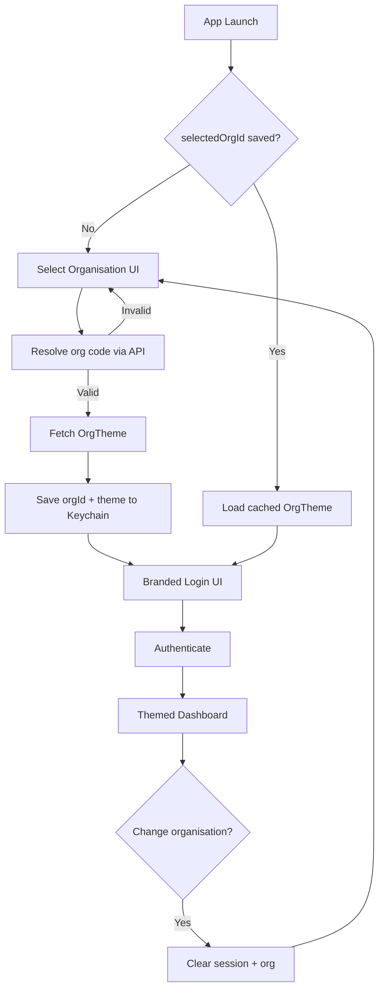

# Corey Patient — White Label Flow Specification

## Goal

Ship one App Store binary (`Corey Patient`) that presents **facility-specific branding** (colors, wallpaper, logo, display name) after the user identifies their **organisation / hospital**. Organisation is chosen once on first launch, remembered on the device, and changeable from settings.

## User journeys

### A. First launch (no saved organisation)

1. User opens the app.
2. **Select Organisation** screen: search list, pick a facility, or enter organisation code manually.
3. App validates the code against the organisation registry (local cache + API).
4. App downloads **OrgTheme** and caches it with `orgId`.
5. **Branded login** appears: wallpaper, navbar color, logo, title — **username and password only** (organisation field removed from login).
6. After successful login → **Dashboard** with org-themed navbar, greeting bar accent, tile borders, and crisis button color.

### B. Subsequent launches

1. User opens the app.
2. App reads `selectedOrgId` from secure local storage.
3. If theme cache is valid → skip organisation picker → **branded login for Organisation A** directly.
4. If theme expired → background refresh, then login.

### C. Change organisation

Available from:

- **Login screen**: “Change Org” control (top right).
- **Profile & Settings → Change organisation…**

Flow: confirm → sign out local session → clear org binding (optional: keep username only) → **Select Organisation** → new theme → new login.

## Screen inventory

| # | Screen | Notes |
|---|--------|--------|
| 1 | Select Organisation | First launch only (unless user changes org) |
| 2 | Login (Org A) | Teal VHA demo theme; example in mockups |
| 3 | Login (Org B) | Navy Memorial theme; proves white-label variance |
| 4 | Dashboard | Uses theme tokens; shows org name in greeting |
| 5 | Profile & Settings | Change organisation entry point |

Mockup PNGs live in `docs/white-label/images/`. PDF: `docs/white-label/CoreyPatient_White_Label_Flow.pdf`.

## Organisation theme model

```json
{
  "orgId": "vhademo",
  "displayName": "VHA Demo Medical Center",
  "appBarTitle": "VHA Patient",
  "primaryColor": "#1A9AB7",
  "secondaryColor": "#EBD699",
  "accentColor": "#F0B27A",
  "loginWallpaperUrl": "https://cdn.example.com/vha/login.jpg",
  "logoUrl": "https://cdn.example.com/vha/logo.png",
  "authBaseUrl": "https://api.example.com/vha",
  "themeVersion": 3
}
```

### UI mapping (from current production UI)

| Element | Theme key |
|---------|-----------|
| Navigation bar | `primaryColor` |
| Login button, input borders | `primaryColor` |
| Greeting bar (dashboard) | `secondaryColor` |
| Crisis line button, some icons | `accentColor` |
| Login background | `loginWallpaperUrl` |
| Nav title | `appBarTitle` |
| Header logo | `logoUrl` |

## Client architecture (iOS)



### Persistence

| Key | Storage | Purpose |
|-----|---------|---------|
| `selectedOrgId` | Keychain | Last organisation |
| `orgThemeJSON` | Keychain or encrypted file | Offline branding |
| `themeFetchedAt` | UserDefaults | TTL for refresh (e.g. 24h) |
| Auth tokens | Keychain | Separate from org selection |

### Routing

| State | Root view controller |
|-------|----------------------|
| No org | `OrganisationSelectionViewController` |
| Org, logged out | `ThemedLoginViewController` |
| Logged in | `ThemedDashboardViewController` |

Apply theme at login container via `ThemeManager.apply(orgTheme)` (nav bar appearance, `UIAppearance`, asset placeholders).

## API contract (suggested)

**GET** `/v1/organisations/lookup?query={text}` — search for Select Organisation list.

**GET** `/v1/organisations/{orgId}/theme` — returns `OrgTheme` JSON.

**POST** `/v1/auth/login` — body includes `orgId`, username, password; base URL may come from theme (`authBaseUrl`) for true multi-tenant backends.

## Migration from current login

Current production login exposes organisation in the **third text field** (`vhademo`). White-label flow:

1. Move organisation capture to **Select Organisation** (first launch).
2. Remove third field from login UI.
3. Pre-fill `orgId` from storage on all API calls.
4. Keep deep link support: `coreypatient://org/vhademo` can pre-select org for enterprise deployments.

## QA checklist

- [ ] First install → Select Organisation → VHA theme on login
- [ ] Kill app → relaunch → login only (no org picker)
- [ ] Change org from settings → Memorial theme on login
- [ ] Invalid org code → inline error, no crash
- [ ] Airplane mode with cached theme → login screen still branded
- [ ] Dashboard reflects new primary/accent after org switch

## Assets in this repo

- Reference (current App Store): `docs/white-label/images/00-reference-dashboard.png`, `00-reference-login.jpg`
- Proposed mockups: `01`–`05` screen PNGs + `06-flow-diagram.png`
- Deliverable PDF: `CoreyPatient_White_Label_Flow.pdf`
